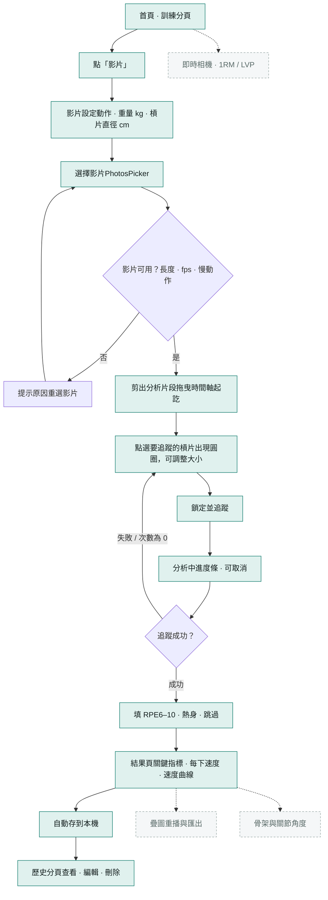
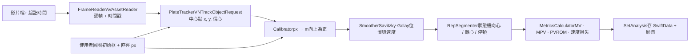
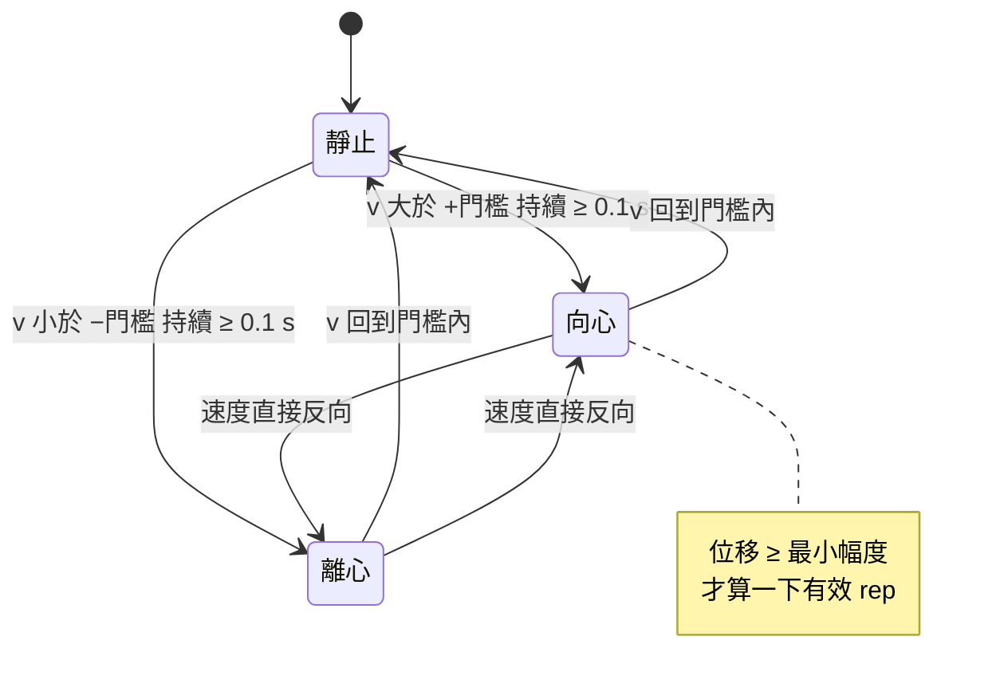

VBT · iOS 17+ · Apple 原生框架

# 槓鈴速度分析 App：流程與技術藍圖

參考 Arcus 的「影片匯入分析」功能拆解。第一版（MVP）範圍是：從相簿選影片、剪出片段、點選槓片、追蹤並算出速度與每下指標，結果存在手機本機。骨架、疊圖重播、即時相機與 1RM 列在後續版本。

SwiftUIVisionAVFoundationAccelerateSwift ChartsSwiftDataPhotosUI

## 01使用者操作流程

綠色節點是 MVP 範圍，虛線框是後續版本。

### 每一步的細節

S1

**影片設定** 選動作（硬舉、相撲硬舉、深蹲、臥推…）、輸入重量、選槓片直徑（預設 45 cm 標準槓片）。

- 動作決定「先向心還是先離心」：硬舉從地上拉起，深蹲和臥推是先往下。
- 槓片直徑是之後把像素換成公尺的比例尺，所以是必填。

S2

**選擇影片** 用 `PhotosPicker`，不需要完整相簿權限。選到後把影片複製到 App 自己的資料夾。

- 檢查：長度、影格率（建議 ≥ 30fps，最好 60fps）、是否為慢動作影片。
- 讀出影片的旋轉方向（`preferredTransform`），之後每一幀都要用正確方向分析。

S3

**剪出分析片段** 上方播放器，下方縮圖時間軸加起訖把手。只分析這一段，縮短時間也減少雜訊。

- 縮圖用 `AVAssetImageGenerator` 產生。
- 只記錄起訖時間，不重新輸出影片。

S4

**點選槓片** 顯示片段第一幀。使用者點槓片中心，出現圓圈，可以雙指縮放讓圓圈貼齊槓片外緣。

- 圓圈直徑（像素）÷ 槓片直徑（公尺）= 比例尺。
- 圓圈外接方框就是追蹤器的初始框。

S5

**追蹤與分析** 在背景逐幀解碼、追蹤槓片中心，接著換算、平滑、微分、切分次數、計算指標。進度即時回報，可取消。

- 追蹤信心太低或連續遺失時中止，請使用者重新點選。

S6

**RPE** 分析完跳出選擇：6、7、7.5、8、8.5、9、9.5、10，或「熱身」、「跳過」。

S7

**結果頁** 影片播放器（可畫上槓鈴軌跡）、本組摘要（重量 × 次數 · RPE）、關鍵指標、每下平均速度長條和下降百分比、展開看向心/離心細節、垂直速度曲線。

- 可以編輯重量與 RPE，指標會用存好的追蹤資料重算，不用重新追蹤。

S8

**儲存與歷史** SwiftData 存組別資料，原始追蹤樣本另外存檔。歷史分頁依日期列出，可刪除（連同影片檔）。

## 02分析管線

從影片到數字的資料流。每個方塊都是一個可以單獨寫測試的模組。

### 次數切分狀態機

門檻預設 0.05 m/s、最小幅度預設 10 cm，兩者都放在參數檔，之後拿實際影片調整。

## 03核心公式

比例尺 scale (m/px) = 槓片直徑 (m) ÷ 圓圈直徑 (px) 垂直位置 y(t) = −(y_px(t) − y_px(t₀)) × scale // 畫面座標往下為正，所以取負號 速度 v(t) = dy/dt // 平滑後微分，時間用影格時間戳 平均速度 MV = 向心位移 ÷ 向心時間 MPV 只算向心段中加速度 ≥ −9.81 m/s² 的推進部分的平均速度 峰值速度 PV = 向心段 v(t) 的最大值 動作幅度 ROM = 向心段起點到終點的垂直位移 速度損失 % = (第 1 下 MV − 最後一下 MV) ÷ 第 1 下 MV × 100

對照 Arcus 影片裡的數字：每下 MV 為 0.28、0.25、0.24 m/s，速度損失 (0.28 − 0.24) ÷ 0.28 ≈ 14.3%，App 顯示 14.2%（四捨五入前的數值不同）。第 2、3 下顯示的 ↓11%、↓14% 也是跟第 1 下比。

**準確度的前提：**從側面拍、手機固定在腳架上、鏡頭跟槓片面垂直、整組動作槓片都在畫面裡。斜著拍時槓片會變成橢圓，比例尺也會不準。App 要在設定頁放「拍攝建議」。

## 04可以達成目標的技術

| 功能 | MVP 採用（Apple 原生） | 替代或之後可加 |
| --- | --- | --- |
| 畫面與導覽 | `SwiftUI`、`NavigationStack`、`@Observable` | — |
| 選影片 | `PhotosUI.PhotosPicker` + `Transferable` 複製檔案 | 從「檔案」App 匯入（`fileImporter`） |
| 播放與剪輯 | `AVPlayer`、`AVAssetImageGenerator` 縮圖 | — |
| 逐幀解碼 | `AVAssetReader` + `AVAssetReaderTrackOutput`，取 `CVPixelBuffer` 與時間戳 | — |
| 槓片追蹤 | Vision `VNTrackObjectRequest` + `VNSequenceRequestHandler`，精準度設 accurate | CoreML 槓片偵測模型做遺失後的重新定位；OpenCV CSRT 追蹤器 |
| 槓片尺寸校正 | 使用者手動調整圓圈 | `VNDetectContoursRequest` 自動貼齊圓形；Core Image 霍夫圓 |
| 訊號處理 | 自寫 Savitzky-Golay（純 Swift，必要時用 `Accelerate/vDSP` 加速） | 卡爾曼濾波 |
| 次數與指標 | 純 Swift 狀態機與計算，放在獨立 Swift Package，可以在 Mac 上直接跑測試 | — |
| 圖表 | `Swift Charts`（折線、面積、長條） | — |
| 資料儲存 | `SwiftData`；影片與原始樣本存在 Application Support | CloudKit 同步 |
| 非同步與效能 | Swift Concurrency（背景 actor、`AsyncStream` 回報進度、可取消） | — |
| 測試 | Swift Testing（`@Test`）、合成訊號、固定測試影片 | XCUITest 跑主流程 |
| 後續：骨架 | `VNDetectHumanBodyPoseRequest`（2D）或 3D 版，三點向量夾角算髖角、膝角 |  |
| 後續：疊圖匯出 | `AVVideoComposition` + Core Animation 或 `AVAssetWriter` 逐幀合成 |  |
| 後續：即時與語音 | `AVCaptureSession` 同一套管線；`AVSpeechSynthesizer` 播報每下速度 |  |
| 後續：1RM / LVP | 同一動作多個重量的「負荷對平均速度」線性回歸，外推到最低速度門檻 |  |

## 05專案結構與 Agent 文件

邏輯放在本機 Swift Package，Claude Code 可以用 `swift test` 在 Mac 上快速驗證演算法，不用每次開模擬器。

AllMight/ ├── CLAUDE.md ← Agent 進專案第一個讀的總說明 ├── docs/ PRD · ARCHITECTURE · FLOW · ALGORITHMS · ROADMAP · DECISIONS · OPEN_QUESTIONS ├── .claude/ │ ├── settings.json ← 允許的指令（xcodebuild、swift test…） │ ├── rules/ ← 永遠遵守或依路徑套用的規則 │ ├── skills/ ← 特定工作的做法（追蹤、速度分析、建置測試…） │ └── agents/ ← 專責審查的子 Agent ├── AllMight/ ← App target（SwiftUI 畫面） └── Packages/VBTKit/ ├── Sources/VBTCore/ ← 純計算：校正、平滑、切分、指標 ├── Sources/VBTVision/ ← 影片解碼、Vision 追蹤 └── Tests/

## 06開發里程碑

M3、M4 是純計算，可以跟 M1、M2 平行開發。每個里程碑的驗收標準寫在 `docs/ROADMAP.md`。

流程依 Arcus 螢幕錄影推測而來，Arcus 實際的程式實作未公開。